<p align="center">
  
</p>

<p align="center">
  <a href="https://vigless.us"></a>
  
</p>

## `$ ls ~/bots`

> they run on their own, every day.

| | bot | what it does | status |
|:-:|---|---|---|
| 🟢 | **vigless** | finds +EV player props, posts them to Discord, and grades every pick overnight | `live` |
| 🟢 | **gamelines** | posts the day's game-line picks to Discord, straight from the model | `live` |
| 🟢 | **tiktok-autoposter** | turns each day's picks into TikTok slides and captions, start to finish | `running` |
| 🟢 | **whop-webhook** | buy on Whop and you get the Premium role on Discord; leave and it's removed | `live` |
| 🟢 | **thecore** | mission control: watches every bot, restarts stuck jobs, writes a daily log, backs it all up | `24/7` |

## `$ ls ~/models`

> they do the thinking. the bots act on it.

| | model | what it does | status |
|:-:|---|---|---|
| 🟢 | **gamelines** | builds its own fair spread and total for every game and flags where the market is off | `live` |
| 🟡 | **tennis** | prices tennis matches and paper-trades when the market gets it wrong | `paper` |
| 🟡 | **longterm** | scores stocks 1–10 on quality, growth, health, value and news, and runs a rules-only paper portfolio | `paper` |
| ⚪ | **move-estimator** | watches a walkthrough video of a home, lists every item, and quotes the move | `building` |

<sub>🟢 live &nbsp;·&nbsp; 🟡 paper-trading (fake money, real results) &nbsp;·&nbsp; ⚪ building</sub>

## `$ cat stack.txt`

<p>
  
  
  
  
  
  
  
  
  
</p>

## `$ ./snake --eat contributions`

<picture>
  <source media="(prefers-color-scheme: dark)" srcset="https://raw.githubusercontent.com/cam3ronport3r/cam3ronport3r/output/snake-dark.svg">
  <source media="(prefers-color-scheme: light)" srcset="https://raw.githubusercontent.com/cam3ronport3r/cam3ronport3r/output/snake-light.svg">
  
</picture>

```console
$ uptime
bots online 24/7 · picks graded every night · everything backed up every morning
$ echo $MOTTO
process over picks.
```
